<p align="center">
  
</p>

<h1 align="center">🍌 Feelable: <em>every diagram, feelable</em></h1>

<p align="center">
  <b>Snap a textbook diagram. Get a picture a blind student can <u>feel</u> and <u>hear</u>.</b><br>
  <sub>Banana Hacks 2026 · image AI hackathon · built 10–12 October 2026</sub>
</p>

<p align="center">
  <a href="https://feelable.onrender.com"></a>
  <a href="DEVPOST.md"></a>
  <a href="docs/video/feelable-demo.mp4"></a>
</p>

<p align="center">
  <a href="https://github.com/TYK3/feelable/actions/workflows/ci.yml"></a>
  
  
  
  
  
  
</p>

<a id="-watch-the-demo"></a>

<p align="center">
  <a href="docs/video/feelable-demo.mp4">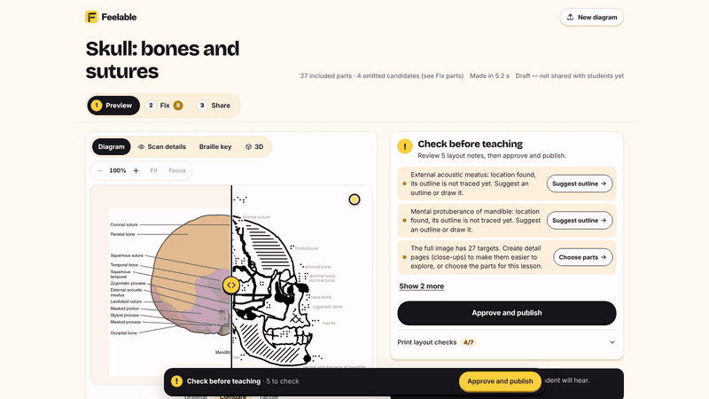</a><br>
  <a href="docs/video/feelable-demo.mp4"><b>▶ Watch the full demo (2 min 54 s)</b></a> · <a href="docs/video/feelable-demo.srt">subtitles</a>
</p>

The video shows the story behind Feelable, then a real photo being processed (not sped up), the dense skull lesson and its Scan details, the teacher's fix tools, a flowchart and a bus map, publishing with a QR code and 3D relief, and a student exploring on a phone. It was recorded from the running app and narrated with an open text-to-speech model (Kokoro); [`docs/video/src`](docs/video/src) rebuilds it.


<table align="center">
<tr>
<td align="center" width="33%">🖨️<br><b>Swell-paper PDF</b><br><sub>Print, heat, and the lines rise. Textures, braille labels and a braille key page.</sub></td>
<td align="center" width="33%">🧊<br><b>3D-printable relief</b><br><sub>A watertight STL of the same diagram.</sub></td>
<td align="center" width="33%">📱<br><b>Talking touch mode</b><br><sub>Touch to hear a part, double-tap for more, and feel a buzz at each edge.</sub></td>
</tr>
</table>

<a id="description"></a>

> **One-paragraph description.** Blind students learn from the same textbooks as everyone else, but every diagram has to be remade by hand as a tactile graphic. That takes hours per figure, and students wait weeks. Feelable is an image AI tool for their teachers. Photograph a diagram and Feelable reads every label with neural OCR, follows each pointer line, segments the structures (splitting same-coloured neighbours along their real edges), and uses Gemini vision to find anything whose pointer is lost. It then generates a tactile page that follows the design rules for touch: raised outlines, a different texture for each neighbouring part, and braille labels. It also makes a 3D-printable relief and a talking touch mode for the student's phone. The teacher reviews, fixes and approves every part before a student sees it.

---

<details open>
<summary><b>📑 Contents</b> (click to collapse)</summary>

| | |
|---|---|
| 🎬 [Watch the demo](#-watch-the-demo) · 🧭 [Judges' tour](#-judges-a-2-minute-tour) | 🏆 [Award categories](#-award-categories-we-are-eligible-for) |
| 🖼️ [The ten lessons](#️-the-ten-lessons-five-basic-five-complex) | ✅ [Rules and submission checklist](#-hackathon-rules-and-submission-checklist) |
| 📖 [The story](#-the-story-behind-feelable) · 🎯 [The problem](#-the-problem-statement) | 🙏 [Credits and AI tools used](#-credits-and-ai-tools-used) |
| ⚙️ [How it works](#️-how-it-works-image-ai-from-start-to-finish) | 🛠️ [Run it yourself](#️-run-it-yourself) |
| 🏗️ [Architecture](#️-architecture-how-the-pipeline-and-services-fit-together) | 🗺️ [Repo map](#️-run-it-yourself) |
| 📊 [Measured results](#-measured-results) | 🚧 [Known limits](#-known-limits) |
| 🎯 [The judging criteria](#-how-feelable-meets-each-judging-criterion) | ❓ [Questions and answers](#-questions-and-answers) |

</details>

---

## 📖 The story behind Feelable

<table>
<tr><td>

When Banana Hacks announced its theme, *image everything*, we looked at what image AI projects usually make: stories turned into comics, outfit try-ons, room redesigns, sketches turned into websites. They are clever, but every one of them makes **pictures for people who can see**.

So we asked the opposite question:

<h3 align="center">💭 Who does image AI leave out?</h3>

Once we asked it, the answer was obvious: **people who can't see the image at all.**

Then we looked at how a diagram reaches a blind student today, and the answer surprised us. It reaches them **by hand**.

1. A teacher of the visually impaired, or a specialist transcriber, redraws every figure from scratch.
2. They simplify it, choose a texture for each part, and swap labels for braille.
3. They print it on swell paper, then heat it until the lines rise.

That takes 10–15 minutes for a simple diagram and **hours for a complex one**, around 300 hours for a single textbook. So students wait **weeks**.

AI image describers don't close the gap. Research on AI descriptions of STEM images found they miss the **structure** a blind student needs ([source](https://scitepress.org/publishedPapers/2024/129968/pdf/index.html)). "The left ventricle is a chamber of the heart" doesn't tell you that it sits **bottom right, below the left atrium, beside the septum**. Only a shape under your finger does that.

That became our idea:

<h3 align="center">✋ Use image AI not to make a new picture for the eyes,<br>but to remake an existing picture for the fingers.</h3>

</td></tr>
</table>

> 🎬 **Picture this** *(what we are building toward; it has not yet been tested in a classroom)*
>
> Before a biology lesson, the teacher photographs the heart diagram on page 112. By the time the class opens their books, the blind student in the front row has a raised-line copy on her desk, and a phone that says *"left ventricle"* when her finger finds it. She is learning **the same page, in the same lesson, at the same time** as everyone else.

---

## 🎯 The problem statement

<table>
<tr><td>

### Blind and partially sighted students are taught from diagrams they cannot see. Turning each diagram into something they can touch takes a specialist hours, so students wait weeks, and they fall behind in the subjects that depend on diagrams most: biology, physics, geography, maths and computing.

</td></tr>
</table>

<p align="center"><b>How might we turn any textbook diagram into an accurate, touchable, talking lesson in seconds, while keeping the teacher in control?</b></p>

<table>
<tr>
<td align="center" width="33%"><h3>⏱️ hours</h3><sub>to hand-make one complex tactile diagram<br>(<a href="https://arxiv.org/abs/2504.04722">TactileNet</a>)</sub></td>
<td align="center" width="33%"><h3>📚 ~300 h</h3><sub>to adapt one textbook<br>(<a href="https://nemo.asee.org/public/conferences/327/papers/38322/download">ASEE</a>)</sub></td>
<td align="center" width="33%"><h3>📅 weeks</h3><sub>that students wait for their materials<br>(<a href="https://carleton.ca/news/story/communicating-visual-information-vision-impaired">Carleton University</a>)</sub></td>
</tr>
</table>

### Why the options that exist today fall short

| Today's option | ✅ Good at | ❌ Falls short |
|---|---|---|
| ✍️ Hand-made tactile graphics | Accurate, made by an expert | Hours per diagram, and specialist time is scarce |
| 📦 Transcription services | Professional quality | Weeks of turnaround, so the lesson has moved on |
| 🗣️ AI image descriptions | Instant | Say *what* is there, not *where*. Nothing to feel. |
| 🎨 Generic image AI | Makes beautiful pictures | Makes them for eyes |
| 🍌 **Feelable** | **A structure-aware draft in seconds, as a print, a 3D model and a talking phone** | The teacher still checks it, and we think that is right |

### Who it is for

- 👩‍🏫 **Teachers of blind students** get a print-ready first draft in seconds instead of an hour, and they approve every part.
- 🧑‍🎓 **Blind students** can explore on swell paper, on a 3D print, or with no printer at all on a phone that speaks.
- 🏫 **Schools** can use it on day one: the core pipeline runs on our own server **with no paid API**.

---

## 🧭 Judges: a 2-minute tour

| Step | Do this | You'll see |
|:---:|---|---|
| **1** | Open **[feelable.onrender.com](https://feelable.onrender.com)**. If the free server is asleep, wait about 50 s. | Ten prepared lessons with a **Basic / Complex** filter |
| **2** | Open **Skull: bones and sutures** and drag the **Original ↔ Tactile** slider | 27 targets, each with its own texture and braille label |
| **3** | Open the **Scan details** tab | Every label it read, every pointer it followed, every shape it traced |
| **4** | On the **Share** step, scan the QR code with a phone and open **Touch mode** | Touch a bone to hear its name; double-tap for its description |
| **5** | Click **Download PDF** or open the **3D** tab | A print-ready swell-paper page (page 2 is the braille key) and a 3D relief |
| **6** | Use **Take photo** or **Choose photo** with your own diagram | A new lesson in about 15–40 s |

---

## 🖼️ The ten lessons: five basic, five complex

Every featured lesson was reviewed and corrected in Feelable. Click any card to try it live.

<details open>
<summary><b>🟢 Basic</b></summary>

| | |
|:---:|:---:|
| <a href="https://feelable.onrender.com">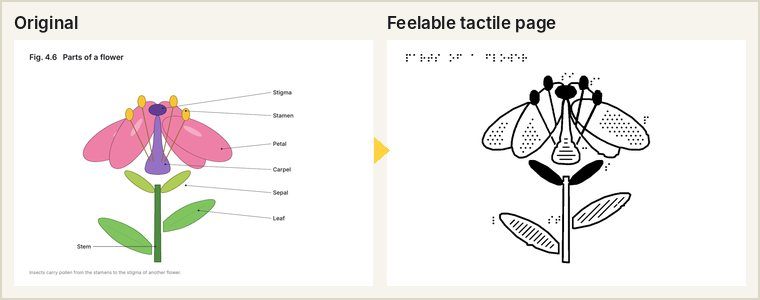</a><br>**Parts of a flower** · biology | <a href="https://feelable.onrender.com">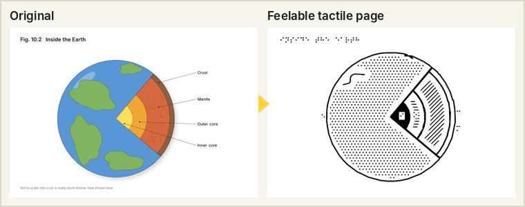</a><br>**Layers of the Earth** · geography |
| <a href="https://feelable.onrender.com">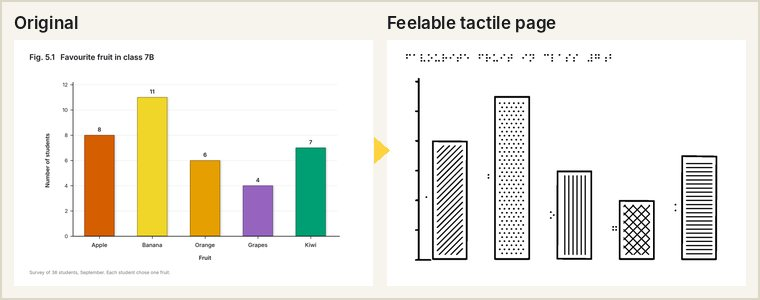</a><br>**Favourite fruit** · a bar chart that speaks its values | <a href="https://feelable.onrender.com">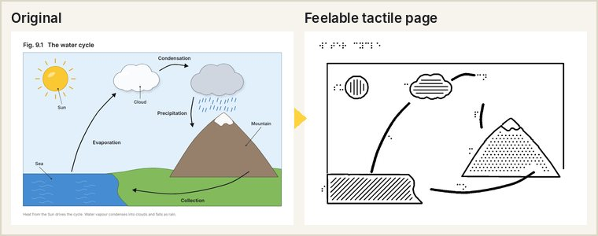</a><br>**Water cycle** · its four processes become arrows you can follow |
| <a href="https://feelable.onrender.com">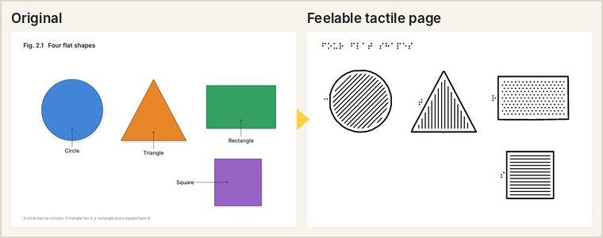</a><br>**Four flat shapes** · maths | |

</details>

<details open>
<summary><b>🔴 Complex</b></summary>

| | |
|:---:|:---:|
| <a href="https://feelable.onrender.com">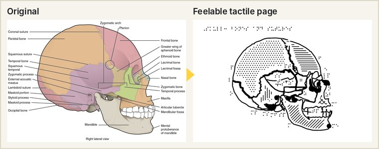</a><br>**Skull: bones and sutures** · 27 targets; sutures traced as borders | <a href="https://feelable.onrender.com">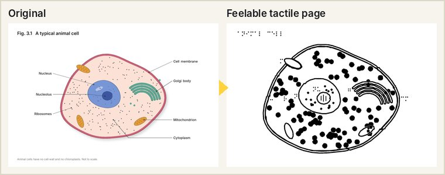</a><br>**Animal cell** · organelles and a set of ribosome dots |
| <a href="https://feelable.onrender.com">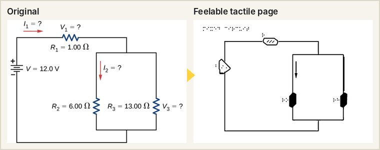</a><br>**Mixed circuit** · components with their values | <a href="https://feelable.onrender.com">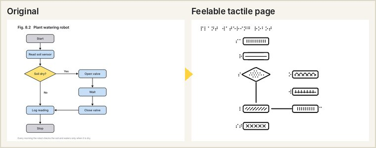</a><br>**Plant watering robot** · a flowchart spoken with its Yes/No branches |
| <a href="https://feelable.onrender.com">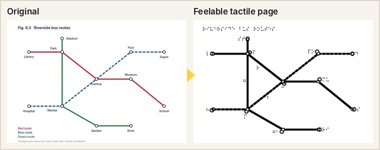</a><br>**Riverside bus routes** · stations, routes and the stops where routes meet | |

</details>

<sub>An extended library on the site holds eight earlier examples (plant cell, heart, digestive system and others). Some of their outlines have not been re-checked, and the site says so.</sub>

---

## ⚙️ How it works: image AI from start to finish

> Image AI is the product. **Every output is built from what the vision pipeline finds in the picture.** Take it away and there is nothing to print, feel or hear.

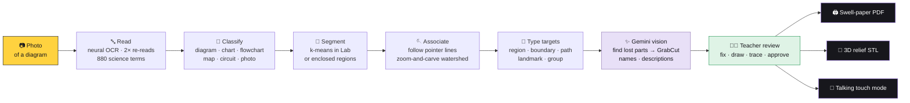

| 1 · Read every label | 2 · Follow each pointer | 3 · Trace the shapes | 4 · Make it feelable |
|---|---|---|---|
|  |  |  |  |

<sub>Figure: OpenStax <i>Anatomy &amp; Physiology</i>, CC BY 4.0.</sub>

<details>
<summary><b>🧠 Model choices and why</b> (click to expand)</summary>

| Job | What we use | Why this one |
|---|---|---|
| Read labels | **PP-OCR** through RapidOCR (ONNX, CPU) | Runs on a free server with no key, and finds small text in figures. |
| Fix misread labels | 2× re-read plus a RapidFuzz match against 880 science terms | Turns "Parktatbone" into "Parietal bone". Common English words are never changed. |
| Split parts | k-means (Lab), marker-controlled watershed, GrabCut (OpenCV) | Fast and explainable. A cut is accepted only when it sits on a real edge in the picture. |
| Find lost structures, name unlabelled parts, write descriptions | **Gemini 3.5 Flash** (vision), with Flash-Lite as a fallback | Its points and boxes are refined into exact outlines by our own segmentation. |
| Voice | Gemini text-to-speech | A natural voice. The device voice takes over at once if it fails. |
| 3D relief | trimesh | Every STL is checked to be a clean, watertight solid. |

Reading, segmenting, tracing and rendering all run **without an API key**. Gemini adds grounding, names, descriptions and the voice. Every AI sentence carries a visible **AI** badge, and the teacher can edit it.

</details>

<details>
<summary><b>🧩 Feelable understands structure, not just pixels</b> (click to expand)</summary>

| Target type | Example | What Feelable does |
|---|---|---|
| **Region** | a bone, an organ | Outlines the whole part and gives it its own texture |
| **Boundary** | the coronal suture | Traces the border two bones share, not a dot at the end of a pointer |
| **Path** | "Evaporation" | An arrow from the sea to the cloud, with a direction |
| **Graph** | a flowchart, a bus map | Boxes and arrows, spoken as "Soil dry? A decision. Yes: open valve. No: log reading."; or stations, routes and the stops where routes meet |
| **Landmark** | the pterion | A point |

If Feelable finds where something is but not how far it goes, it says **"location found, extent unresolved"**. It offers **Trace the border** or **Draw** rather than pretending it is done.

</details>

## 🏗️ Architecture: how the pipeline and services fit together

> **Are there AI agents?** No autonomous agents. Feelable is a **fixed, auditable pipeline** of vision stages. Gemini is called as a tool at set points, each with a fallback, so the same photo always takes the same route. The teacher, not a model, makes the final call. We chose this on purpose: a tactile graphic has to be predictable and checkable, and it has to work when the AI service is down.

### System overview

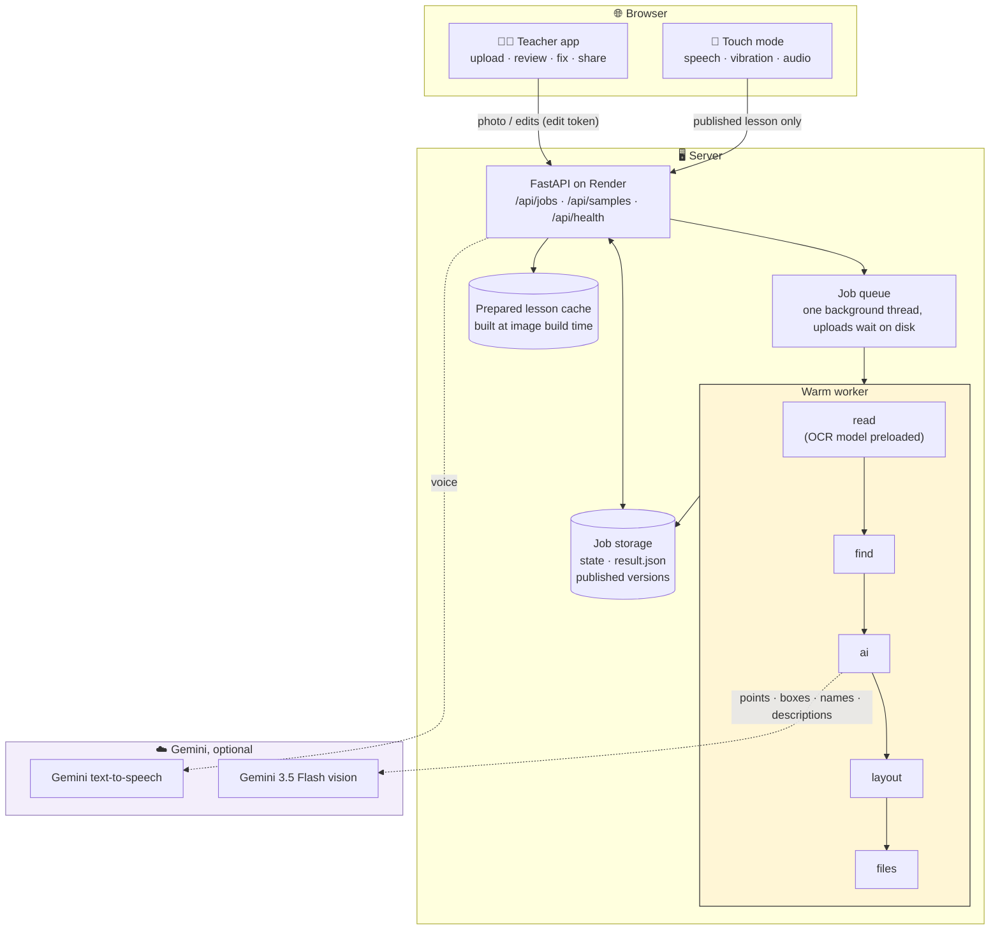

### What each stage does

The progress screen shows these same stages while a photo is processed.

| Stage | Module | What happens | If it fails |
|---|---|---|---|
| **read** · *Reading labels* | `analyze.py`, `ocr.py`, `lexicon.py` | Rotate, flatten and resize; check for a quarter turn; neural OCR; re-read unsure words from a 2× zoom; snap to 880 science terms; classify the picture | An OCR engine failure is reported with **Try again**, never passed off as "no text" |
| **find** · *Finding the parts* | `analyze.py`, `grounding.py`, `vision_utils.py` | Segment; trace pointer lines; zoom-and-carve; give each label a typed target (region, boundary, path, landmark or group); build flowchart edges and map routes | Unmatched labels go to the readiness panel with **Draw** or **Trace the border** |
| **ai** · *Describing each part* | `ai.py` | Gemini locates structures whose pointer is lost (refined by GrabCut), names unlabelled parts and writes descriptions | Skipped with no key. On an error, the lesson still finishes and the reason is shown |
| **layout** · *Applying tactile rules* | `tactile.py`, `textures.py`, `braille.py` | 1.5 mm outlines, enlarged tiny parts, distinct neighbouring textures, UEB braille keys, rules measured on the result | A failed rule becomes a readiness warning |
| **files** · *Braille, PDF and 3D* | `export.py` | Swell-paper PDF with a key page, print PNG, watertight STL (built when first asked for) | |

### A lesson's life

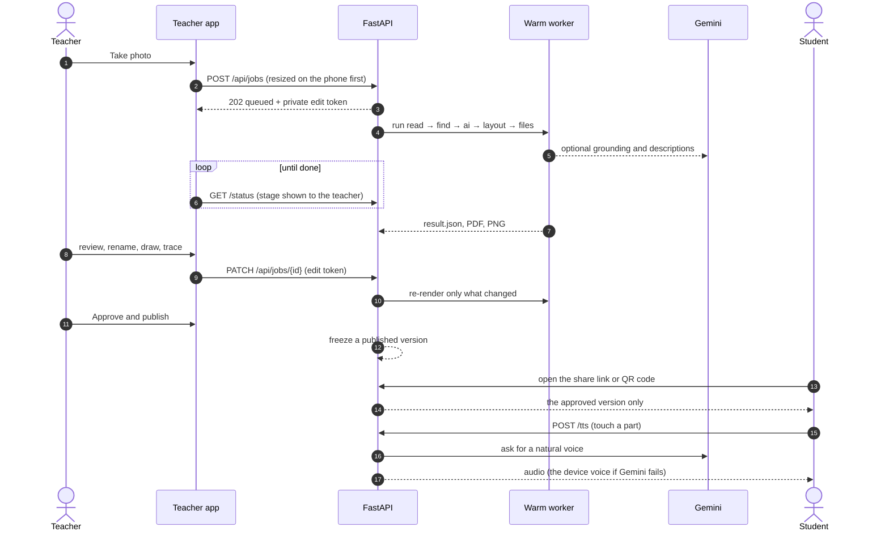

<details>
<summary><b>🛡️ Built to survive a free 512 MB server</b> (click to expand)</summary>

- **One warm worker process.** The OCR model loads once. Jobs run one at a time, so memory stays flat. The worker is recycled every 20 jobs.
- **A 300-second deadline per job.** A stuck worker is killed and replaced, so one bad photo can't block everyone else.
- **Uploads wait on disk, not in memory.** Phones resize photos before uploading. The server handles EXIF rotation and HEIC, and caps image size.
- **The STL is built lazily**, only when someone asks for it.
- **Prepared lessons are built into the Docker image**, so they open instantly. Each one is stamped with its source image hash and annotation version, and a stale one is never served.
- **`/api/health`** reports the commit the server is running.

</details>

<details>
<summary><b>🔐 Who can see and change what</b> (click to expand)</summary>

- Each lesson lives in its own folder: the state, `result.json`, and the exported files.
- The **teacher** gets a private link with an **edit token**. Every change needs that token.
- **Approve and publish** freezes a numbered version. **Students** get a read-only link and QR code that only ever serves the approved version. Touch mode tells them if the lesson was updated.
- Lessons show their expiry date. The Gemini key lives only in the server environment.

</details>

---

## 📊 Measured results

We count **where outlines land, not just how many labels were read**. Every number comes from a script in `qa/`.

### 🎯 Hand-annotated targets (`qa/precision`)

```text
valid targets     before ███████████████░░░░░░░░░░░░░░░░  67/142
                  after  ███████████████████████░░░░░░░░ 104/142
critical errors   before ████████████████  16
                  after  ██████████        10
```

| Input | Before | After |
|---|:---:|:---:|
| 💀 Fresh skull photo | 14/25 · 3 critical | **18/25 · 2 critical** |
| 💧 Water cycle | 4/8 · 2 critical | **8/8 · 0 critical** ✅ |
| 🔀 Flowchart | 4/12 · arrows 0/11 | **12/12 · arrows 11/11** ✅ |
| 🚌 Bus map | 1/15 · routes 0/15 | **15/15 · routes 15/15** ✅ |
| 🔌 Rotated circuit | 0/4 | **3/4** |
| 📓 Handwritten notebook organs | 5/10 · 1 critical | **6/10 · 0 critical** |

> ⚠️ **Honest caveats:**
> - We wrote the annotations ourselves, by hand from the source images (never from Feelable's output).
> - We used these images while building the fixes, so this is **not** a held-out accuracy claim.
> - The blurred skull gained one critical error (2 → 3).
>
> Details are in [`docs/FIX-STATUS-2026-10-12-precision.md`](docs/FIX-STATUS-2026-10-12-precision.md).

<p align="center">
  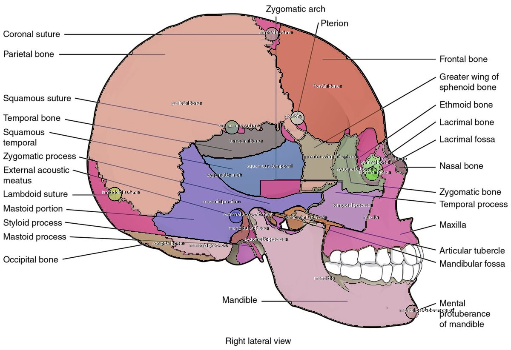
  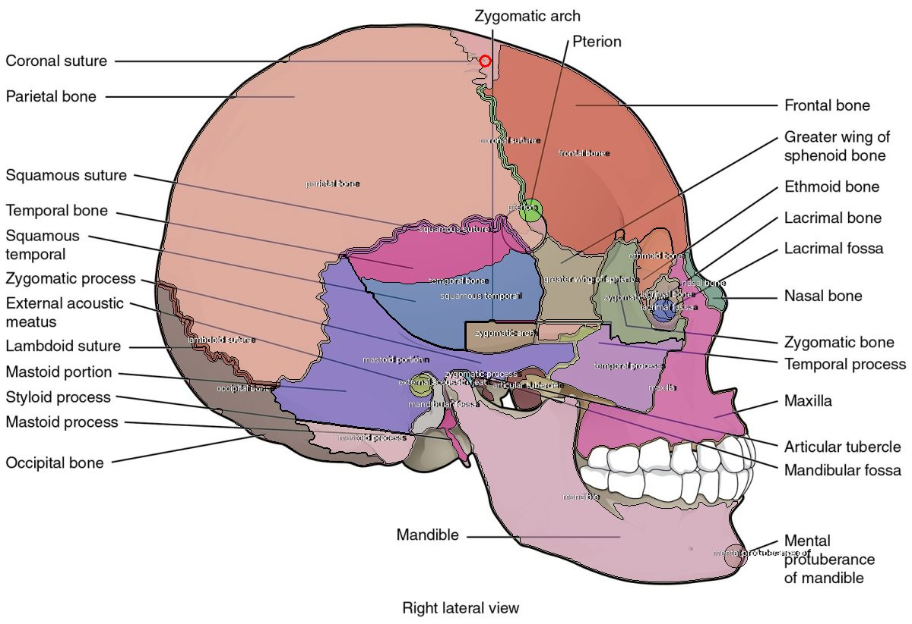
  <br><sub><b>Before → after:</b> sutures are now traced along the border two bones share.</sub>
</p>

<details>
<summary><b>📚 Dense anatomy benchmark and robustness</b> (click to expand)</summary>

**Dense anatomy** (`qa/dense`): 24 figures (skulls, eye, ear, kidney, digestive system, heart, and 420 px low-resolution copies), run offline with AI off.

| | Before | Now |
|---|:---:|:---:|
| Labels read correctly | 94 % | **99 %** |
| Labels that became a named, feelable shape | 52 % | **71 %** |

**Robustness** (`qa/robustness`): 239 public images (objects, animals, scenes, maps, charts, handwriting, odd file formats, phone-like distortions).

| | Baseline | Now |
|---|:---:|:---:|
| Crashes | 0 | 0 |
| Images with junk output | 192 | 114 |
| Runs over 512 MB | 63 | 4 |
| Worst-case memory | 5.3 GB | 962 MB |

**Tests:**
- **304 backend tests**, including the annotated end-to-end targets.
- **Playwright browser checks** at 1440, 390 and 320 px: 27 + 16 checks.
- **A gallery gate** that fails if any featured lesson has a missing, unnamed or misplaced part.

</details>

---

## 🎯 How Feelable meets each judging criterion

Each criterion is scored from 1 to 5, and all five count equally.

<table>
<tr><th width="22%">Criterion</th><th>Our case</th><th width="22%">Evidence</th></tr>
<tr><td>⚙️ <b>Technical execution and difficulty</b></td><td>A multi-stage vision pipeline, not an API wrapper: neural OCR with zoomed re-reads, pointer tracing across crossings, zoom-and-carve watershed, boundary tracing, flowchart and map graph extraction, Gemini grounding refined by GrabCut, tactile rules measured on the output, UEB braille and watertight STL. Graded against hand-annotated targets.</td><td><a href="#️-architecture-how-the-pipeline-and-services-fit-together">Architecture</a>, <code>qa/target_score.py</code>, <a href="#-measured-results">results</a></td></tr>
<tr><td>💡 <b>Innovation and creativity</b></td><td>Image AI aimed at <b>fingers instead of eyes</b>. One photo becomes a raised-line print, a 3D relief and a phone you can touch and hear. Sutures as borders, arrows as paths and flowcharts as graphs are what a blind reader needs, and what describers leave out.</td><td><a href="#️-how-it-works-image-ai-from-start-to-finish">How it works</a></td></tr>
<tr><td>🖼️ <b>Use of the image AI theme</b></td><td>The image is both the input and the output. Vision reads, segments and grounds the picture, and Feelable <b>generates</b> a new image designed for touch, a 3D model and speech. Remove the image AI and nothing is left.</td><td><a href="#️-the-ten-lessons-five-basic-five-complex">The ten lessons</a></td></tr>
<tr><td>🌍 <b>Impact and usefulness</b></td><td>A measured bottleneck (hours per diagram, weeks of waiting) and a clear user (teachers of blind students). It is free to run, needs no key for the core, and has teacher approval built in.</td><td><a href="#-the-problem-statement">The problem</a></td></tr>
<tr><td>🎨 <b>Design, presentation and demo</b></td><td>Upload → Review → Fix → Share. 48 px touch targets, no sideways scroll at 320 px, a talking touch mode, the Basic/Complex gallery, and a <b>Scan details</b> tab that shows the AI's work on your own picture. Demo video of 3 minutes or less.</td><td><a href="https://feelable.onrender.com">Live site</a>, <a href="docs/video/feelable-demo.mp4">demo video</a>, <a href="DEVPOST.md">write-up</a></td></tr>
</table>

---

## 🏆 Award categories we are eligible for

Every submission is considered for every category, so nothing needs applying for.

| Award | Fit | Why |
|---|:---:|---|
| 🥇 **Top project** | 🟢🟢🟢 | Strong across all five criteria |
| 🎨 **Best Creative Tool** | 🟢🟢🟢 | Image AI in the hands of a teacher **making** something. The teacher stays the author: they review, rename, draw a missing part on the photo, trace a border, write what the student hears, and approve. |
| 🤯 **Most Surprising Output** | 🟢🟢🟢 | An image AI project whose output is a picture you **can't see but can feel**: raised lines with braille, a 3D-printed relief, and a phone that speaks a flowchart's Yes/No branches under your finger. |
| 🙌 **People's Choice** | 🟢🟢 | Easy to grasp in five seconds. Close your eyes, touch the phone, and hear "left ventricle". |

---

## ✅ Hackathon rules and submission checklist

<details open>
<summary><b>📦 What we hand in</b></summary>

| Required | Ours |
|---|---|
| Project name | **Feelable** |
| One-paragraph description | [At the top of this README](#description) and in [`DEVPOST.md`](DEVPOST.md) |
| Public GitHub link | https://github.com/TYK3/feelable |
| Demo video, 3 minutes or less | ✅ [**Watch the demo (2:54)**](docs/video/feelable-demo.mp4), with subtitles in [`feelable-demo.srt`](docs/video/feelable-demo.srt) |
| Demoable without hardware | ✅ Hosted at https://feelable.onrender.com and works over a screen share. A printer is optional. |

</details>

<details open>
<summary><b>📜 Submission rules</b></summary>

| Rule | How we meet it |
|---|---|
| Teams of 1–4, one team each | ✅ |
| Built during the hacking window. The deadline is **Sun 11 Oct, 11:59 PM AoE** (Mon 12 Oct, 12:59 UK time). | ✅ Every commit in this repo is dated inside the window. Check with `git log --reverse --format='%h %ad'`; the first commit is 10 Oct 2026, 22:45 UK time. |
| Public repo with commits inside the window | ✅ This repo is public, and its commit timestamps are not altered. |
| Addresses the theme (generative and image AI) | ✅ See [how it works](#️-how-it-works-image-ai-from-start-to-finish) |
| Libraries, APIs and models cited in the README | ✅ See [credits](#-credits-and-ai-tools-used) |
| Generative AI tools named | ✅ See [AI tools we used](#-credits-and-ai-tools-used) |
| Available for a sponsor demo call if we win | ✅ |
| Banana Hacks may feature the project | ✅ Agreed |

</details>

<details>
<summary><b>🤝 Code of Conduct</b> (click to expand)</summary>

We follow the Banana Hacks Code of Conduct and the [MLH Code of Conduct](https://mlh.io/code-of-conduct).

- **Privacy.** No participant's personal information appears in the repo, the app or the demo. The demo video shows only our own team, filmed with their agreement. No one else's video feed or messages are recorded or shared.
- **Content.** All sample and test images are textbook figures, public test images or our own drawings, credited below. Nothing sexualised or offensive is in any channel, file or submission.
- **Security.** No secrets are committed: the Gemini key lives only in the hosting dashboard. Feelable does not touch the event's infrastructure. If we found a security hole in the event's systems, we would report it privately to the organisers.
- **Teacher control as a safety feature.** Students only see a lesson after a teacher approves it, and every AI-written sentence is marked as AI.

Concerns about this project can go to the organisers through **#help** on Discord or **team@bananahacks.tech**.

</details>

---

## 🙏 Credits and AI tools used

<details open>
<summary><b>🤖 Generative AI tools we used</b> (disclosed as the rules ask)</summary>

| Tool | Used for |
|---|---|
| **Google Gemini 3.5 Flash / Flash-Lite** (vision) | Inside the product: finding structures whose pointer is lost, naming unlabelled parts, writing spoken descriptions |
| **Google Gemini text-to-speech** | Inside the product: the natural voice in touch mode |
| **Kokoro-82M** text-to-speech (open model) | The demo video's narration and the phone's voice in it (not used inside the product) |
| **Claude (Anthropic), through Claude Code** | Building the product: an AI coding assistant for code, tests, the QA harness and documentation. Commits it helped write carry a `Co-Authored-By: Claude` trailer. |

</details>

<details>
<summary><b>🧠 Pre-trained models</b></summary>

- **PP-OCR** text detection and recognition models (PaddleOCR, Apache 2.0), run through **RapidOCR** (`rapidocr-onnxruntime`, Apache 2.0) on **ONNX Runtime** (MIT)
- **Google Gemini 3.5 Flash, Flash-Lite and text-to-speech** through the Gemini API
- **Kokoro-82M** (Apache 2.0), run with **sherpa-onnx** (Apache 2.0): the narration voices in the demo video only

</details>

<details>
<summary><b>📦 Open-source libraries</b></summary>

**Backend (Python):**
- FastAPI and Uvicorn (the server)
- python-multipart and httpx (uploads and requests)
- NumPy, OpenCV and Pillow (image work)
- pillow-heif (HEIC photos)
- Shapely (geometry)
- trimesh and mapbox-earcut (the 3D relief)
- RapidFuzz (label repair)
- pytest (tests)

**Web (TypeScript):**
- React and React DOM
- Vite and TypeScript
- three.js (the 3D view)
- qrcode (share codes)
- Fontsource Inter and Bricolage Grotesque fonts (SIL OFL)

**Browser APIs:** Web Speech, Vibration and Web Audio.

**QA:** Playwright (browser checks).

</details>

<details>
<summary><b>🖼️ Images and datasets</b></summary>

- **OpenStax** *Anatomy & Physiology*, *Biology* and *University Physics Volume 2* (CC BY 4.0). Used for the skull, heart and digestive-system lessons, the mixed circuit and benchmark figures, some fetched through the philschatz GitHub mirrors.
- **Feelable original artwork** (CC0): flower, Earth layers, bar chart, water cycle, shapes, flowchart, bus map, plant and animal cells, circuit and volcano (`samples/make_samples.py`, `samples/make_featured.py`). The handwritten notebook drawing was made by our team.
- **Robustness set** (`qa/robustness/manifest.csv` gives every image's source URL and licence):
  - OpenStax (CC BY 4.0)
  - ImageNet samples
  - test images from Pillow, OpenCV, scikit-image, matplotlib, Tesseract and EasyOCR
  - OpenMoji (CC BY-SA 4.0)
  - d2l.ai (CC BY-SA 4.0)
  - Natural Earth (public domain) through d3-geo and cartopy
  - OpenStreetMap contributors through Leaflet
  - handwriting samples from the githubharald repository
  - Kubernetes docs (CC BY 4.0)
  - Ultralytics and darknet assets

</details>

<details>
<summary><b>📖 Research we drew on</b></summary>

- TactileNet, [arXiv:2504.04722](https://arxiv.org/abs/2504.04722): time to make tactile graphics by hand
- ASEE, [paper 38322](https://nemo.asee.org/public/conferences/327/papers/38322/download): hours to adapt a textbook
- Carleton University, [communicating visual information to people with vision impairments](https://carleton.ca/news/story/communicating-visual-information-vision-impaired)
- BANA *Guidelines and Standards for Tactile Graphics*, and Unified English Braille (UEB)

</details>

---

## 🛠️ Run it yourself

<details>
<summary><b>Install and run in 5 minutes</b> (click to expand)</summary>

You need Python 3.11+ (built on 3.13) and Node 18+ (built on 22).

```bash
pip install -r backend/requirements.txt         # add --break-system-packages on some Linux setups
cd web && npm install && npm run build && cd ..
./run.sh                                        # → http://localhost:8000
```

On Windows, double-click `start-windows.bat`.

To turn on the optional Gemini features:

```bash
export GEMINI_API_KEY=...             # never commit this
export GEMINI_MODEL=gemini-3.5-flash  # optional
```

**Development:**
- `make dev` runs the API on :8000, and `make web` runs Vite on :5173.
- `make test` runs the backend tests.
- `cd web && npx tsc -b --noEmit` type-checks the web app.

**Quality checks:**

```bash
python qa/bulk_eval.py /tmp/eval qa/precision/inputs/* --truth qa/precision/truth   # hand-annotated targets
python qa/check_gallery.py                                                         # the ten featured lessons
python qa/e2e_precision.py http://localhost:8000 /tmp/shots                         # browser checks
```

**Deploy:** `render.yaml` is a Render Blueprint (one free Docker service). Pushes to `main` deploy automatically. If one doesn't, use **Manual Deploy → Deploy latest commit** in the Render dashboard. `/api/health` shows the running commit. See [`DEPLOY.md`](DEPLOY.md).

</details>

<details>
<summary><b>🗺️ Repo map</b> (click to expand)</summary>

| Path | What it does |
|---|---|
| `backend/engine/analyze.py` | Reads the image: classification, OCR, segmentation, pointers, flowcharts, maps |
| `backend/engine/grounding.py` | Label-to-geometry association: zoom-and-carve, boundary tracing, paired parts |
| `backend/engine/ocr.py`, `lexicon.py` | Neural OCR, zoomed re-reads, the 880-term vocabulary |
| `backend/engine/ai.py` | Gemini grounding, names, descriptions, text-to-speech |
| `backend/engine/tactile.py`, `textures.py`, `braille.py`, `export.py` | Tactile rules, textures, UEB braille, PDF and STL |
| `backend/engine/pipeline.py` | Jobs, the readiness check, teacher edits |
| `backend/app/main.py` | FastAPI server |
| `web/src/pages`, `web/src/components` | Teacher app |
| `web/src/touch/` | Talking touch mode and the "Find the…" game |
| `samples/` | Lessons, `manifest.json` (reviewed corrections), art generators |
| `qa/` | Benchmarks, target scorer, gallery gate, browser checks |
| `docs/` | Fix reports, evidence, README art (`docs/img/make_readme_art.py`) |

</details>

---

## 🚧 Known limits

- 📏 **Not a 90 % accuracy claim.** There is no independent, held-out annotated set yet.
- 🌫️ **Pale and blurred figures are the weakest.** The low-contrast notebook scores 3/10, and the blurred skull has one more critical error than before.
- 💀 **Some skull parts are still wrong.** The zygomatic arch is mis-outlined, and the mastoid parts overlap their neighbours.
- 🔀 **Flowchart arrows are mostly missing from the raised-line page.** The boxes are drawn, and the spoken descriptions give every arrow (11/11), but only some arrows are printed as lines.
- 🔌 **The mixed circuit reads R3 as "Rg".** Series/parallel wiring is not extracted.
- 🧑‍🦯 **Not yet tested with blind students, specialist teachers, real screen readers on phones, or real swell-paper and STL prints.** This is our most important next step.
- 😴 **The free server sleeps.** The first visit after a quiet spell is slow.

---

## ❓ Questions and answers

<details>
<summary><b>Where did the idea come from?</b></summary>

From looking at what image AI usually makes (comics, try-ons, redesigns) and asking who it leaves out. People who can't see images get nothing from a better picture. Then we found that their diagrams are still remade by hand, taking hours each and weeks of waiting. See [the story](#-the-story-behind-feelable).

</details>

<details>
<summary><b>Isn't this just an image description API with extra steps?</b></summary>

No. A describer returns a sentence. Feelable has to know **where every part is and exactly where its edge runs**, because a finger follows that edge.

Most of the work is our own computer vision: OCR with zoomed re-reads, pointer tracing, watershed carving, and boundary and graph extraction. Gemini helps where a pointer is lost, and our segmentation turns its point and box into an exact outline.

</details>

<details>
<summary><b>Where is the <i>generative</i> part?</b></summary>

From one photo, Feelable generates four new pieces of media:
- a tactile image designed by rule for fingers (textures, enlarged parts, braille);
- a 3D relief mesh;
- spoken descriptions written by Gemini;
- a Gemini voice.

The output is a new picture, just one meant to be felt.

</details>

<details>
<summary><b>Does Feelable use AI agents?</b></summary>

No. It is a fixed pipeline (read → find → ai → layout → files), and Gemini is called as a tool at set points, each with a fallback. That keeps every result predictable and explainable: the **Scan details** tab shows each step. It also means a lesson still works when the AI service is down. The teacher makes the final decision, not a model. See [architecture](#️-architecture-how-the-pipeline-and-services-fit-together).

</details>

<details>
<summary><b>Why not ask a large vision model to segment everything?</b></summary>

We do use Gemini for grounding, as points and boxes. A raised line has to sit exactly on the real edge, though, and a hosted model costs money and needs a network on every run.

So our own segmentation draws the final outline. It runs free on a CPU, it is explainable (the **Scan details** tab shows every step), and it accepts a cut only when it sits on a real edge.

</details>

<details>
<summary><b>How do you know the outlines are right?</b></summary>

We score against hand-annotated targets, not label counts:
- a region must cover its own points and nobody else's;
- a suture must cover its whole course.

Valid targets went from 67 to 104 of 142, and critical errors went from 16 to 10. We also list what is still wrong under [known limits](#-known-limits).

</details>

<details>
<summary><b>What happens when Feelable gets something wrong?</b></summary>

The readiness panel lists problems first, each with a fix: **Draw** a missing part on the photo, **Trace the border**, **Exclude nearby area**, rename or merge.

Blocking issues stop publication. For example, a title that braille cannot spell blocks publishing. Students only see a lesson after the teacher approves it.

</details>

<details>
<summary><b>Does a school need a 3D printer or swell paper?</b></summary>

No. Touch mode works on any phone: touch to hear, double-tap for more, and feel a buzz at edges. Swell paper and 3D prints are extras for schools that have them.

</details>

<details>
<summary><b>Does it work without an internet AI service?</b></summary>

Yes. Reading, segmenting, tracing and the PDF and STL all run on our server with no API key. Gemini adds lost-part finding, names, descriptions and the natural voice. If Gemini fails, the lesson still works and the page says why.

</details>

<details>
<summary><b>What kinds of pictures can it handle?</b></summary>

- labelled science diagrams
- charts with values
- process diagrams with arrows
- flowcharts
- maps with routes
- circuits
- geometry
- photos of real objects
- handwritten notebook drawings

Pale, blurred and very crowded figures are the weakest.

</details>

<details>
<summary><b>Is braille handled properly?</b></summary>

Labels and keys use UEB grade 1 braille, placed beside each part with a clear pad, plus a key page. If a title has characters braille can't spell here, such as "H₂O" or Chinese characters, publishing is blocked until the teacher edits it, instead of the characters being silently dropped.

</details>

<details>
<summary><b>Why would anyone keep using this after the weekend?</b></summary>

- The problem is measured in hours per diagram.
- The core is free to run.
- The output follows the tactile rules that specialist teachers already use.
- The teacher stays in control.

Next we will test with teachers of the visually impaired and blind students, then build a shared, approved library so each textbook diagram only has to be converted once.

</details>

<details>
<summary><b>Did you use AI to build it?</b></summary>

Yes, and we say so as the rules ask. **Gemini** runs inside the product (vision, descriptions, voice). **Claude (Anthropic)** helped us write code, tests and documentation as a coding assistant. The idea, the product decisions and the review of every change are ours. See [credits](#-credits-and-ai-tools-used).

</details>

<details>
<summary><b>What was hardest?</b></summary>

Dense textbook figures: two dozen small labels over bones of nearly the same colour, with pointer lines that cross. Making an image was never the hard part. Making one that **fingers can read correctly** was.

</details>

<details>
<summary><b>Is the content licensed for use?</b></summary>

Yes. The OpenStax figures are CC BY 4.0, credited in `samples/manifest.json` and above. Our own samples are released CC0. Every test image's source and licence is listed in `qa/robustness/manifest.csv`.

</details>

---

<p align="center">
  <br>
  <sub><b>Feelable.</b> Every diagram, feelable.</sub>
</p>
