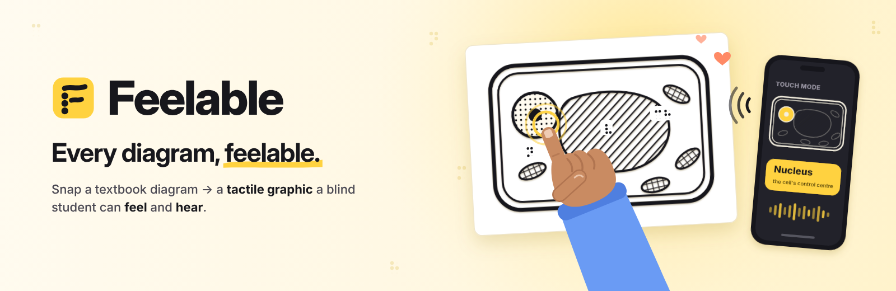
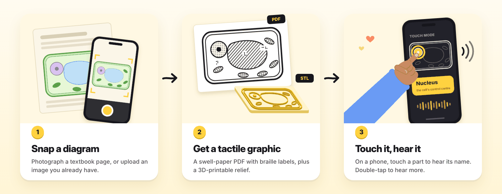
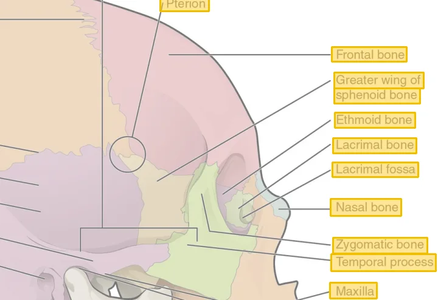
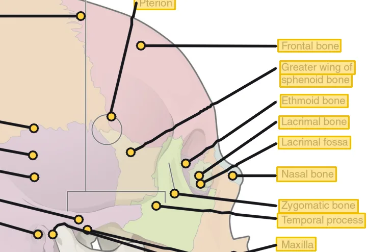
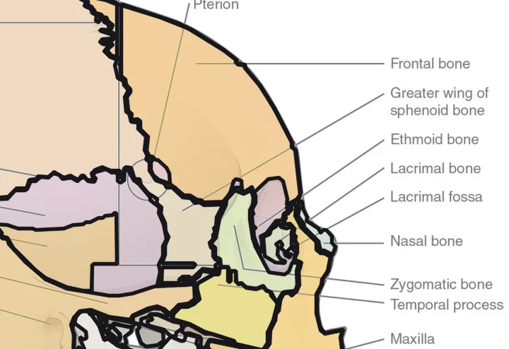
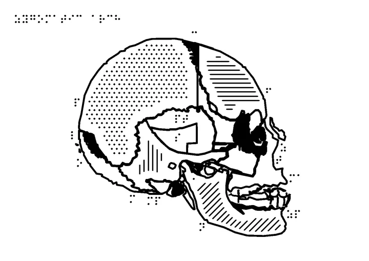

<p align="center">
  
</p>

<p align="center">
  <a href="https://feelable.onrender.com"></a>
  <a href="https://github.com/TYK3/feelable/actions/workflows/ci.yml"></a>
  
  
</p>

# Feelable — *Every diagram, feelable.*

**Snap a photo of a textbook diagram → get a tactile graphic a blind student can feel and hear.** In seconds a teacher gets a **swell-paper PDF** (print it, heat it, the black lines rise) with braille labels and a braille key, a **3D-printable relief** (STL), and a **talking touch mode** for the student's phone: touch a part → hear its name, double-tap → hear more, feel a buzz on edges.

**Live demo:** https://feelable.onrender.com (free server: first visit after idle takes ~50 s to wake; samples open instantly, new photos take ~15–40 s) · **Code:** https://github.com/TYK3/feelable

Built for **Banana Hacks 2026** (online, Oct 9–12 · submissions close **Sun 11 Oct, 23:59 EDT = Mon 04:59 UK**).

### How it works

<p align="center"></p>

### Why it matters

Blind students use the same textbooks as everyone else, but every diagram has to be hand-made into a tactile graphic: **10–15 minutes for a simple one, hours for a complex one** ([TactileNet](https://arxiv.org/abs/2504.04722)), and around **300 hours per textbook** ([ASEE](https://nemo.asee.org/public/conferences/327/papers/38322/download)). Students **wait weeks** ([Carleton](https://carleton.ca/news/story/communicating-visual-information-vision-impaired)). AI describers say *what* a diagram is, not *how it's built*, which is what a blind learner needs. Feelable gives the teacher a print-ready first draft in seconds, follows tactile-graphics rules (1.5 mm outlines, distinct textures for neighbours, enlarged tiny parts, UEB braille keys) and measures them on the output, and keeps the teacher in control of every part.

### How it reads a dense diagram

Small print, pointer lines that cross, neighbouring structures of the same colour: the hard part of a real textbook figure. Feelable reads it up close, one label at a time, and the review page's **How it read** tab shows every step on your own picture.

| 1 · Read every label | 2 · Follow each pointer | 3 · Trace the shapes | 4 · Make it feelable |
|---|---|---|---|
|  |  |  |  |
| On-device OCR; blurry words re-read from a 2× zoom and repaired against 880 science terms | Leader lines traced from each label to its tip | Colour segmentation, then **zoom-and-carve**: a seeded watershed on a magnified crop splits regions that share a colour along their real edges; with AI on, **Gemini visual grounding** locates structures whose pointer is lost | Tactile rules applied and measured; UEB braille keys; watertight STL |

Measured on a 24-image benchmark of dense anatomy figures (your phone screenshots, OpenStax textbook figures and 420 px low-res copies; `qa/dense/`), offline with AI off:

| | before | now |
|---|---|---|
| labels read correctly | 94 % | **99 %** |
| labels that became a named, feelable shape | 52 % | **71 %** |

Figure: OpenStax *Anatomy & Physiology*, CC BY 4.0.

---

## 1. Run it (5 minutes)

Requirements: Python 3.11+ (built on 3.13), Node 18+ (built on 22).

```bash
# backend deps
pip install -r backend/requirements.txt        # add --break-system-packages on some Linux setups
# web deps + build
cd web && npm install && npm run build && cd ..
# start (serves the web app AND the API on one port)
./run.sh                                       # → http://localhost:8000
```

The vision pipeline runs on the server without any API key (OCR reads the diagram's labels locally). Gemini is optional: with a key it names unlabelled parts, describes object photos and writes spoken descriptions.
Optional: better part names/descriptions with Gemini:
```bash
export GEMINI_API_KEY=...            # optional
export GEMINI_MODEL=gemini-3.5-flash # optional, change if the model name differs
```

Dev mode (hot reload): `make dev` (API on :8000) + `make web` (Vite on :5173, proxies /api to :8000).
Tests: `make test` (255 backend tests, ~2.5 min). Web typecheck: `cd web && npx tsc -b --noEmit`.

Try it: open http://localhost:8000 → click a sample (plant cell, heart, water cycle…) → review page → **Download PDF / STL** → **Open touch mode** (try it on a phone on the same Wi-Fi: use your computer's LAN IP, not `localhost`).

---

## 2. How it works

```
Photo ─► analyze (engine/analyze.py)                         ─► tactile (engine/tactile.py) ─► export (engine/export.py)
         • resize, flatten photographed page                      • A4/Letter landscape, 5 px/mm       • tactile.pdf (2 pages: drawing + braille key)
         • OCR labels offline (rapidocr)                          • drop clutter, outlines 1.5 mm      • relief.stl (watertight, 2 mm base + 1 mm relief)
         • colour (k-means) or line-art segmentation              • enlarge tiny parts ≥ 6 mm          • tactile.png / tactile_print.png / legend.png
         • leader-line detection → label ↔ part matching          • distinct textures for neighbours
         • clutter removal, nesting, chart values                 • braille (UEB grade 1) keys + legend
         • optional Gemini enrichment (engine/ai.py)              • 7 guideline checks, measured on the raster
```
API: FastAPI (`backend/app/main.py`, pipeline glue `backend/engine/pipeline.py`). Web: React + Vite + TS (`web/src`): teacher app (`pages/`, `components/`) and touch mode (`touch/`).
Shared types: `backend/engine/types.py`, `web/src/types.ts`, `web/src/api.ts`.

### Repo map
| Path | What | Built by |
|---|---|---|
| `backend/engine/analyze.py, ocr.py, ai.py, vision_utils.py` | Understanding the diagram | Vision team |
| `backend/engine/braille.py, tactile.py, textures.py, export.py` | Tactile rendering, braille, PDF/STL | Tactile team |
| `backend/app/*`, `backend/engine/pipeline.py`, `run.sh`, `Makefile` | HTTP API, jobs, storage | API team |
| `web/src/App.tsx, router.ts, pages/, components/, styles/` | Teacher web app | Web-Teacher team |
| `web/src/touch/` | Talking touch mode (+ "Find the part" game) | Web-Touch team |
| `samples/` | 10 test/demo diagrams + `manifest.json` + generator | Content team |
| `backend/engine/types.py`, `web/src/types.ts`, `web/src/api.ts` | Shared contract | Lead |
| `docs/mock/` | Mock API + data for frontend work | Lead |

---

## 3. Status of the 10 samples (offline mode, no AI)

All run end to end in 2–6 s each on a laptop, every expected label matched:

| Sample | Parts found (braille key) |
|---|---|
| plant-cell / plant-cell-photo | cell wall (c), cytoplasm (cy), vacuole (v), chloroplast ×5 (ch), nucleus (n), mitochondrion ×3 (m); ribosome dots dropped |
| heart | heart wall, left/right ventricle, left/right atrium, aorta, pulmonary artery, vena cava, septum (9 parts → "8 or fewer" flagged) |
| water-cycle | sun, cloud ×2, sea, mountain; land = background (off); arrows as raised lines |
| animal-cell | cytoplasm, nucleus, cell membrane, golgi body, mitochondrion ×3, nucleolus |
| earth-layers | earth (contains the 4 layers), crust, mantle, outer core, inner core |
| bar-chart | 5 bars with values ("Banana. 11 — number of students. Bar 2 of 5, the tallest.") |
| circuit | battery, bulb, switch, resistor |
| flower | petal, sepal, stamen, carpel, stigma, stem, leaf |
| volcano | ash cloud, lava, vent, cone, crust, magma chamber |

---

## 4. Features

- **Any photo works, not just textbooks.** Input is classified as diagram, chart, object photo, scene, text page or blank.
  - Object photos are traced as a subject outline. With AI on, Gemini names their parts using bounding boxes, e.g. a mouse photo → body, left/right button, thumb rest.
  - Phone photos are resized on the device; on the server they get EXIF rotation, HEIC support and capped memory.
- **AI that you can see.** An "AI" badge on every Gemini-written description, a **Describe with AI** button, and a clear reason whenever AI fails.
- **Teacher workflow:**
  - real progress stages and Cancel;
  - a readiness check with blocking issues and an approval step before teaching;
  - original↔tactile compare slider and click-to-select parts;
  - split/merge;
  - drafts survive navigation;
  - limits are enforced without truncating text.
- **Teacher repair tools:** **Draw a missing part** on the original photo (mouse or keyboard). **Close-up lesson** turns a crowded area into an enlarged second lesson and keeps the names.
- **Natural AI voice** (Gemini TTS) in touch mode, with an instant fallback to the device voice and a voice picker.
- **Students see only the approved version** of a lesson; the teacher gets a labelled draft preview.
- **Safe sharing:** read-only student link and QR code; a private teacher link (edit token); expiry shown; touch mode tells students when the lesson was updated.
- **Robustness:** 239 internet images (objects, animals, scenes, maps, charts, handwriting, odd files, phone-like variants). The harness is in `qa/robustness/`.

  | | Baseline | Now |
  |---|---|---|
  | Crashes | 0 | 0 |
  | Images with junk output | 192 | 114 |
  | Runs over 512 MB | 63 | 4 |
  | Worst-case memory | 5.3 GB | 962 MB |

- **255 backend tests**, web typecheck clean, end-to-end flow checked against the real backend at 390 px and 1280 px.

**To deploy a new commit:** Render dashboard → feelable → **Manual Deploy → Deploy latest commit**.


## 5. Gotchas
- Port 8000 is the real server; `docs/mock/mock_server.py` is a fake API for frontend work (use another port, e.g. `PORT=8101`).
- OCR (`rapidocr-onnxruntime`) loads its model on first call (+~1 s).
- Copy-link for a student's phone won't work with `localhost` — use the computer's LAN IP or a deployed URL.
- iOS Safari has no vibration API; speech needs the "Tap to start" gesture (already handled).
- The AI path (Gemini) is tested live on Render. If Gemini fails, the job still succeeds with OCR labels, and the review page shows the reason.
